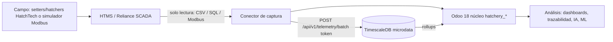
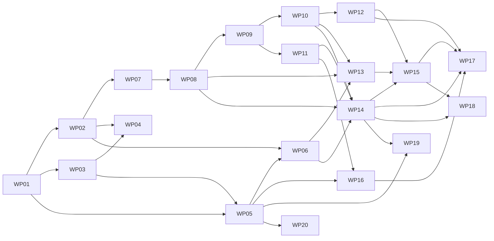

# Ficha técnica — ERP para planta de incubación (Odoo 18)

Versión 1.3 · 27-10-2026 · Edición confirmada: Odoo 18 Community · Autor: Diego Eduardo Rivas Revilla
Estado: especificación para implementación por paquetes de trabajo (Cursor Cloud). Los ítems marcados **[POR CONFIRMAR]** dependen de la planta; los marcados **[POR VERIFICAR]** requieren comprobación técnica o contable antes de implementarse.

---

## 1. Objetivo, alcance y supuestos

### 1.1 Objetivo
Construir un ERP modular sobre Odoo 18 Community para una planta de incubación de pollo de carne que integre producción, planificación, almacén, calidad, mantenimiento, bioseguridad, personal, costos y contabilidad peruana, con trazabilidad por lote desde la granja reproductora hasta el cliente, telemetría de solo lectura desde las máquinas HatchTech, analítica interactiva, asistente conversacional y modelos predictivos de ciclo.

### 1.2 Alcance
- Incluido: 18 módulos (sección 3), simulador de planta con configuración gráfica, ingesta de microdata, reportes interactivos, asistente IA, ML de ciclo, contabilidad PCGE/IGV/PLE.
- Opcional: facturación electrónica SUNAT vía OSE (módulo según 3.15), optimización automática de carga (OR-Tools).
- Excluido: escritura sobre el SCADA o las máquinas (fase futura, no recomendada), nómina completa, app móvil nativa (se usa PWA en tablet).

### 1.3 Principios
1. El ERP informa, planifica, recomienda y alerta; las personas ejecutan los cambios físicos. Los cambios de plan generan instrucciones (`hatchery.task`) para el personal.
2. Solo lectura hacia máquinas y HTMS.
3. Modular tipo LEGO: cada módulo se instala de forma independiente; todo catálogo es dato maestro editable.
4. El lote es el hilo conductor de todos los módulos.

### 1.4 Supuestos de dimensionamiento
| Parámetro | Valor | Estado |
|---|---|---|
| Huevos cargados/día | 30 000 | Meta |
| Setter | HatchTech S42240 (42 240 huevos, 6 carros, 480 bandejas de 88) | [POR CONFIRMAR] modelo real |
| Setters | 20 (18 d ciclo + 1 limpieza = 19, +1 reserva) | Supuesto |
| Hatcher | HatchTech H28800 (28 800 huevos) | [POR CONFIRMAR] |
| Hatchers | 5 (3 d + 1 limpieza = 4, +1 reserva) | Supuesto |
| Transferidos/día | 26 000–27 000 | Estimado |
| Pollitos/día | ~25 000 (≈97 % de primera) | Estimado |
| Variables por máquina | 20 (3–12 temperatura, HR, CO₂, volteo, ventilador, válvulas, alarmas) | [POR CONFIRMAR] |
| Muestreo | 10 s recomendado | [POR CONFIRMAR] |
| Zona horaria | America/Lima (UTC-5); almacenamiento en UTC | Definido |

### 1.5 KPIs de referencia (industria / Aviagen)
Fertilidad 90–95 % · Incubabilidad (HoT) 82–88 % · HoF 90–94 % · Pérdida de peso día 18: 10,5–12,5 % · Rendimiento pollito 67–68 % · Edad del huevo al cargar ≤ 7 d.

---

## 2. Arquitectura, despliegue y seguridad

### 2.1 Capas


| Capa | Componente | Tecnología |
|---|---|---|
| Campo | Máquinas o `simulator` | Python 3.12, `pymodbus` 3.x, Modbus TCP :5020 |
| Captura | `connector` | Python, adaptadores `CsvSource`, `SqlSource`, `ModbusSource`; cola local SQLite |
| Datos | `tsdb` | PostgreSQL 16 + TimescaleDB 2.x |
| Núcleo | `odoo` | Odoo 18 Community + addons `hatchery_*` + OCA |
| Análisis | `analytics` | FastAPI (ML, chatbot, API de series), scikit-learn, MLflow |
| Proxy | `nginx` | TLS, rate limiting |

### 2.2 docker-compose.yml (referencia)
```yaml
services:
  db:            # base de Odoo
    image: postgres:16
    environment: [POSTGRES_USER=odoo, POSTGRES_PASSWORD_FILE=/run/secrets/db_pw, POSTGRES_DB=postgres]
    volumes: [db_data:/var/lib/postgresql/data]
    secrets: [db_pw]
  tsdb:          # microdata
    image: timescale/timescaledb:2.17.2-pg16
    environment: [POSTGRES_USER=ts, POSTGRES_PASSWORD_FILE=/run/secrets/ts_pw, POSTGRES_DB=telemetry]
    volumes: [ts_data:/var/lib/postgresql/data]
    secrets: [ts_pw]
  odoo:
    image: odoo:18.0
    depends_on: [db]
    volumes: [./addons:/mnt/extra-addons, odoo_data:/var/lib/odoo, ./config/odoo.conf:/etc/odoo/odoo.conf]
  analytics:
    build: ./analytics
    depends_on: [tsdb, odoo]
    environment: [TSDB_DSN_FILE=/run/secrets/ts_ro_dsn, ODOO_URL=http://odoo:8069, LLM_PROVIDER=${LLM_PROVIDER}]
  connector:
    build: ./connector
    environment: [SOURCE=modbus, API_URL=http://analytics:8000/api/v1, MODBUS_HOST=simulator, MODBUS_PORT=5020, BATCH_SIZE=2000, BATCH_SECONDS=5]
    volumes: [connector_queue:/data]
  simulator:
    build: ./simulator
    ports: ["127.0.0.1:8090:8090"]   # UI gráfica; solo loopback del host (ver 2.3)
  nginx:
    image: nginx:1.27
    ports: ["443:443"]
    depends_on: [odoo, analytics, simulator]
volumes: {db_data: {}, ts_data: {}, odoo_data: {}, connector_queue: {}}
secrets: {db_pw: {file: ./secrets/db_pw}, ts_pw: {file: ./secrets/ts_pw}, ts_ro_dsn: {file: ./secrets/ts_ro_dsn}, odoo_admin_passwd: {file: ./secrets/odoo_admin_passwd}}
```
`admin_passwd` de Odoo sale del secreto `odoo_admin_passwd` (archivo local, nunca en el repositorio). `list_db = False`. Windows: Docker Desktop + WSL2; script `scripts/start.ps1`. Linux: `make up`. Despliegue autoalojado (Community): servidor en planta o VPS; tipo [POR CONFIRMAR] (pregunta 15).

### 2.3 Seguridad
- Token por dispositivo (`hatchery.device.token`, hash SHA-256, rotación 90 d, revocable); cabecera `Authorization: Bearer`.
- Red: solo `nginx` se expone a la red; `tsdb` y `db` en red interna. El puerto 8090 de la sección 2.2 se publica solo en `127.0.0.1` para la UI local y no en otras interfaces. Conector en VLAN de planta, sin rutas de escritura al SCADA.
- Usuario `ts_ro` de solo lectura para analytics/chatbot; `ts_writer` solo INSERT para el conector.
- TLS 1.2+, contraseñas en Docker secrets, nunca en el repositorio.
- Grupos de acceso Odoo por rol (sección 6.3) y reglas de registro (`ir.rule`) por planta/compañía.
- Rate limit API: 20 req/s por token; payload máx. 2 MB.
- Registro de auditoría (sección 10).

### 2.4 API (OpenAPI 3.1 en `/api/v1/openapi.json`)
| Método | Ruta | Uso |
|---|---|---|
| POST | `/api/v1/telemetry/batch` | Lote de lecturas `{device, readings:[{ts, sensor, value, quality}]}`; respuesta 202 con `accepted`, `rejected` |
| GET | `/api/v1/series?machine=&sensor=&from=&to=&bucket=1m` | Series para gráficos |
| GET | `/api/v1/lots/{name}/trace` | Trazabilidad completa del lote |
| POST | `/api/v1/assistant/ask` | Pregunta al chatbot |
| GET | `/api/v1/ml/predictions?batch=` | Predicciones del ciclo |
| GET | `/api/v1/health` | Estado de servicios |

---

## 3. Módulos (18 + seguridad transversal)

Convención: prefijo `hatchery_`, licencia LGPL-3, cada módulo con `tests/`, datos demo y `security/ir.model.access.csv`. Dependencia raíz: `hatchery_base`. Todos los módulos base de Odoo citados (`stock`, `purchase`, `sale_management`, `mrp`, `account`, `maintenance`, `hr`, `hr_attendance`, `product_expiry`, `mail`) son de Odoo 18 Community.

### 3.0 Correspondencia con los 18 módulos de la investigación y la Page
| # | Módulo funcional (investigación / Page) | Módulo técnico de esta ficha | Nota |
|---|---|---|---|
| 1 | Datos maestros | `hatchery_base` | — |
| 2 | Abastecimiento de huevo | `hatchery_supply` | En la investigación: `hatchery_base + purchase` |
| 3 | Recepción y clasificación | `hatchery_reception` | En la investigación: parte de `hatchery_production` |
| 4 | Almacén de huevo | `hatchery_stock` | — |
| 5 | Planificación | `hatchery_planning` | — |
| 6 | Incubación (setter) | `hatchery_setting` | Antes `hatchery_production` |
| 7 | Ovoscopia y transferencia | `hatchery_transfer` | Antes `hatchery_production` |
| 8 | Nacimiento (hatcher) | `hatchery_hatching` | Antes `hatchery_production` |
| 9 | Procesado y vacunación | `hatchery_processing` | Antes `hatchery_production` |
| 10 | Despacho y ventas | `hatchery_sales` | — |
| 11 | Calidad | `hatchery_quality` | — |
| 12 | Telemetría | `hatchery_iot` | — |
| 13 | Mantenimiento | `hatchery_maintenance` | — |
| 14 | Bioseguridad | `hatchery_biosecurity` | — |
| 15 | Costos y contabilidad | `hatchery_accounting` | — |
| 16 | Personal y turnos | `hatchery_hr` | Extiende `hr` estándar |
| 17 | Asistente IA | `hatchery_ai` | + servicio `analytics/assistant` |
| 18 | Tableros e informes | `hatchery_dashboard` | Módulo propio, no dentro de `hatchery_quality` |
| Opc. | Facturación electrónica SUNAT | `l10n_pe_edi_base` (OPeru) u OSE externo | Ver 3.15 |
| Servicio | ML y anomalías | `analytics/ml` (fuera de Odoo) | Ver sección 9 |
| Transversal | Roles y permisos (7 roles + personalizados) | `hatchery_security` | Ver 3.19 y 6.3 |

### 3.1 `hatchery_base` — Datos maestros
- **Modelos:** `hatchery.plant` (name, company_id, tz), `hatchery.farm` (name, code, kind: breeder/broiler/client, partner_id, address, senasa_code, receiving_capacity_day, active), `hatchery.breeder.flock` (farm_id, house, genetic_line, hatch_date, age_weeks [compute], health_status), `hatchery.machine.model` (brand, model, kind: setter/hatcher/chamber, capacity_eggs, trolleys, trays_per_trolley, eggs_per_tray, cleaning_days=1), `hatchery.machine` (code, model_id, plant_id, scada_id, state: free/loaded/cleaning/maintenance, x_pos, y_pos), `hatchery.sensor` (machine_id, variable_id, scada_tag, unit, scale, offset, min_ok, max_ok, min_alarm, max_alarm), `hatchery.variable` (code: temp/rh/co2/turn/fan/valve, unit), `hatchery.program` (species_id, days_setter=18, days_hatcher=3, step_ids), `hatchery.program.step` (program_id, day_from, day_to, temp_sp, rh_sp, co2_max), `hatchery.species` (name, incubation_days=21, candling_days="10,18").
- **Vistas:** list y form de todos los modelos; kanban de máquinas por estado; vista de mapa de planta (OWL, posiciones x/y); search con filtros por planta, tipo y estado.
- **Reglas:** `scada_id` único por planta; capacity_eggs > 0; `min_alarm < min_ok < max_ok < max_alarm`.
- **KPIs:** n.º de máquinas por estado; capacidad instalada (huevos).
- **Dependencias:** `base`, `mail`.
- **Aceptación:** crear un modelo de máquina nuevo y 3 sensores sin código; aparece en el mapa y en el simulador.

### 3.2 `hatchery_supply` — Abastecimiento de huevo
- **Modelos:** extiende `purchase.order` (flock_id, expected_eggs); `hatchery.egg.delivery` (farm_id, flock_id, purchase_id, guide_number, lay_date, qty_declared, arrival_dt, shell_temp).
- **Vistas:** list, form, calendar de entregas por arrival_dt; pivot por granja y semana.
- **Reglas:** guide_number único por granja; alerta si qty_declared difiere > 2 % de expected_eggs.
- **KPIs:** cumplimiento de entrega % = recibidos ÷ pedidos × 100.
- **Dependencias:** `hatchery_base`, `purchase`, `stock`.
- **Aceptación:** una entrega validada crea un `stock.lot` de huevo con flock_id y lay_date.

### 3.3 `hatchery_reception` — Recepción y clasificación
- **Modelo:** `hatchery.egg.lot` (name seq `HL/%(y)s/%(seq)05d`, delivery_id, flock_id, lay_date, qty_received, qty_hatchable, qty_dirty, qty_cracked, qty_floor, qty_small, avg_weight_g, storage_days [compute = hoy − lay_date], stock_lot_id).
- **Vistas:** form de captura para tablet (campos grandes, QR); list; graph de % descarte por causa; pivot por granja.
- **Reglas:** qty_received = qty_hatchable + qty_dirty + qty_cracked + qty_floor + qty_small; avg_weight_g entre 45 y 75.
- **KPIs:** % incubable; % descarte por causa.
- **Dependencias:** `hatchery_supply`, `stock`.
- **Aceptación:** captura en tablet < 60 s por lote; el descarte genera movimiento a `WH/Descarte`.

### 3.4 `hatchery_stock` — Almacén de huevo e insumos
- **Configuración:** ubicaciones `WH/Huevo-Frio` (15–18 °C), `WH/Precalentado`, `WH/Setter-XX`, `WH/Hatcher-XX`, `WH/Pollito`, `WH/Insumos`, `WH/Descarte`; productos Huevo fértil, Pollito BB 1.ª/2.ª, vacunas, cajas.
- **Modelos:** extiende `stock.lot` (flock_id, lay_date, storage_days); `hatchery.stock.age.report` (vista SQL por tramo de edad).
- **Vistas:** list y pivot de stock por ubicación y edad; graph de stock por tramo; kanban de ubicaciones.
- **Reglas:** FEFO por lay_date; alerta storage_days > 7; bloqueo blando > 14 (aprobación del jefe de incubación).
- **KPIs:** stock por edad (0–3, 4–7, > 7 d); rotación de insumos.
- **Dependencias:** `hatchery_reception`, `stock`, `product_expiry`.
- **Aceptación:** el reporte de stock por edad coincide con la suma de lotes.

### 3.5 `hatchery_planning` — Planificación
- **Modelos:** `hatchery.load.plan` (date, machine_id, egg_lot_ids, eggs_planned, state: draft/proposed/approved/done), `hatchery.capacity.slot` (machine_id, date_from, date_to, kind: setting/hatching/cleaning/maintenance, batch_id), `hatchery.scenario` (eggs_per_day, horizon_days, result_json).
- **Fórmulas:** ocupación = huevos cargados ÷ capacity_eggs × 100; liberación setter = load_date + 18 d + cleaning_days; hatcher = transfer_date + 3 d + cleaning_days; setters necesarias = ceil(eggs_per_day ÷ capacity_eggs) × (18 + cleaning_days).
- **Vistas:** Gantt de 21 días por máquina (componente OWL propio, porque `web_gantt` solo existe en Enterprise y la empresa usa Community); list y form de planes; graph de ocupación; dashboard de balance oferta de pollitos vs `receiving_capacity_day`.
- **Reglas:** sin solapes de slots; aprobación por grupo Jefe de incubación; plan aprobado crea `hatchery.task` para operarios.
- **KPIs:** ocupación %; días de saturación en el horizonte; excedente/faltante de pollitos.
- **Dependencias:** `hatchery_stock`, `hatchery_hr` (para `hatchery.task`).
- **Aceptación:** escenario de 40 000 huevos/día devuelve máquinas necesarias, días de saturación y huevos adicionales a pedir.

### 3.6 `hatchery_setting` — Incubación (setter)
- **Modelo:** `hatchery.batch` (name `HB/%(y)s/%(seq)05d`, egg_lot_ids, setter_id, hatcher_id, program_id, load_dt, eggs_loaded, weight_load_g, candle_dt, transfer_dt, hatch_dt [computes], state: planned/setting/transferred/hatching/processed/closed). La cuenta analítica (`analytic_account_id`) la agrega `hatchery_accounting`.
- **Vistas:** kanban por state; form con pestañas (lotes, curva, eventos); list; graph de minutos fuera de rango.
- **Reglas:** eggs_loaded ≤ capacity_eggs; un batch activo por slot. El bloqueo por limpieza no verificada lo agrega `hatchery_biosecurity` (3.14).
- **KPIs:** minutos fuera de rango por batch.
- **Dependencias:** `hatchery_planning`.
- **Aceptación:** al cargar, la telemetría queda asociada al batch por máquina + intervalo.

### 3.7 `hatchery_transfer` — Ovoscopia y transferencia
- **Modelos:** `hatchery.candling` (batch_id, day, sample_size, clear, early_dead, mid_dead, contaminated, cracked, weight_d18_g); campos en batch: qty_transferred, in_ovo_vaccine_id.
- **Vistas:** form de captura para tablet; list; graph de fertilidad y pérdida de peso por batch.
- **Fórmulas:** fertilidad = (cargados − claros) ÷ cargados × 100; pérdida de peso = (w0 − w18) ÷ w0 × 100.
- **Reglas:** pérdida fuera de 10,5–12,5 % genera alerta.
- **KPIs:** fertilidad; pérdida de peso día 18; mortalidad temprana y media.
- **Dependencias:** `hatchery_setting`.
- **Aceptación:** la transferencia mueve stock de `Setter-XX` a `Hatcher-XX`.

### 3.8 `hatchery_hatching` — Nacimiento
- **Modelo:** `hatchery.hatch.result` (batch_id, pull_dt, hatched, first_grade, second_grade, culls, pipped_unhatched, avg_chick_weight_g, hatch_window_h).
- **Vistas:** form de captura; list; graph de HoT/HoF por batch; pivot por granja y máquina.
- **Fórmulas:** HoT = hatched ÷ eggs_loaded × 100; HoF = hatched ÷ fértiles × 100; rendimiento = avg_chick_weight_g ÷ avg_egg_weight_g × 100.
- **Reglas:** hatched = first_grade + second_grade + culls.
- **KPIs:** HoT, HoF, rendimiento, ventana de nacimiento.
- **Dependencias:** `hatchery_transfer`.
- **Aceptación:** KPIs calculados al guardar.

### 3.9 `hatchery_processing` — Procesado y vacunación
- **Modelos:** `hatchery.vaccination` (batch_id, vaccine_product_id, lot_id, doses, method: spray/injection/in_ovo, operator_id); sexado opcional (males, females); `mrp.production` por batch con BoM huevo + vacuna + caja → Pollito BB.
- **Vistas:** form de captura; list; pivot de dosis por vacuna y batch.
- **Reglas:** doses ≥ first_grade; vacuna con lote vigente. Catálogo de vacunas editable (Marek, Newcastle, Bronquitis, Gumboro).
- **KPIs:** dosis por pollito; consumo de vacunas por período.
- **Dependencias:** `hatchery_hatching`, `mrp`.
- **Aceptación:** el consumo de vacuna descuenta stock con lote; la orden de producción deja Pollito BB en `WH/Pollito`.

### 3.10 `hatchery_sales` — Despacho y ventas
- **Modelos:** extiende `sale.order` (destination_farm_id, chick_grade); extiende `stock.picking` (boxes, 100 pollitos/caja, guide_number, vehicle_plate, batch_ids); `hatchery.supply.balance` (date, chicks_available, receiving_capacity, orders).
- **Vistas:** list y form de pedidos; calendar de despachos; graph de balance oferta/demanda.
- **Reglas:** alerta si pollitos disponibles > capacidad de destinos (excedente) o < pedidos (faltante).
- **KPIs:** cumplimiento de pedidos %; excedente diario.
- **Dependencias:** `hatchery_processing`, `sale_management`.
- **Aceptación:** la guía imprime batch de origen y granja reproductora.

### 3.11 `hatchery_quality` — Calidad
- **Modelos:** `hatchery.breakout` (batch_id, sample, infertile, early, mid, late, pipped, contaminated, malformed), `hatchery.chick.quality` (batch_id, reflex, navel, legs, beak, belly, pasgar_score). La pérdida de peso se toma de `hatchery.candling`.
- **Vistas:** form de captura; list; graph y pivot por granja, edad de reproductora y máquina.
- **Reglas:** suma de categorías = sample.
- **KPIs:** fertilidad, HoT, HoF, mortalidad por etapa, Pasgar promedio.
- **Dependencias:** `hatchery_hatching`.
- **Aceptación:** comparación por granja, edad de reproductora y máquina contra rangos de referencia.

### 3.12 `hatchery_iot` — Telemetría
- **Modelos:** `hatchery.device.token` (machine_id, token_hash, expires, active), `hatchery.alarm` (machine_id, sensor_id, batch_id, start, end, level: warning/alarm, max_dev, ack_by), `hatchery.deviation`, `hatchery.reading.hourly` (rollup 1 h sincronizado).
- Datos crudos en TimescaleDB (sección 5); Odoo guarda solo alarmas y rollups horarios.
- **Vistas:** list y form de alarmas; kanban de alarmas activas; graph de alarmas por máquina.
- **Reglas:** desvío > umbral durante ≥ 5 min abre alarma; cierra tras 5 min en rango.
- **KPIs:** alarmas por máquina; tiempo medio de acuse.
- **Dependencias:** `hatchery_base`.
- **Aceptación:** un desvío inyectado en el simulador abre alarma en < 60 s.

### 3.13 `hatchery_maintenance` — Mantenimiento
- **Modelos:** extiende `maintenance.equipment` (machine_id, run_hours, cycles); `hatchery.calibration` (sensor_id, date, ref_value, measured, error, next_date).
- **Vistas:** kanban de solicitudes (estándar); list y form de calibraciones; calendar de preventivos.
- **Reglas:** preventivo cada N ciclos u horas; 3 alarmas iguales en 24 h crean solicitud; mantenimiento bloquea slot en planificación.
- **KPIs:** cumplimiento preventivo %, MTBF, MTTR.
- **Dependencias:** `hatchery_iot`, `hatchery_planning`, `maintenance`.
- **Aceptación:** la tercera alarma igual en 24 h crea solicitud y bloquea la máquina en el Gantt.

### 3.14 `hatchery_biosecurity` — Bioseguridad
- **Modelos:** `hatchery.cleaning` (machine_id, date, product, operator_id, verified_by), `hatchery.swab` (location, date, result_cfu, passed), `hatchery.visit` (person, company, vehicle_plate, origin_farm, last_poultry_contact, shower), `hatchery.senasa.book` (origen de huevo y destino de pollito BB por batch, D.S. 029-2007-AG).
- **Vistas:** list y form; calendar de limpiezas; reporte QWeb del libro SENASA.
- **Reglas:** máquina sin limpieza verificada no puede cargarse.
- **KPIs:** cumplimiento de limpieza %; hisopados aprobados %.
- **Dependencias:** `hatchery_setting`, `hatchery_sales`.
- **Aceptación:** exporta libro SENASA en PDF/XLSX por período.

### 3.15 `hatchery_accounting` — Costos y contabilidad
- **Base:** `l10n_pe` (Community: PCGE, impuestos, tipos de documento), IGV 18 %, OCA `account_financial_report` (18.0, verificado).
- **Modelos:** extiende `hatchery.batch` (analytic_account_id); `hatchery.batch.cost` (batch_id, egg_cost, energy_cost, vaccine_cost, box_cost, labor_cost, depreciation, total, cost_per_chick).
- **Fórmulas:** costo por pollito = total ÷ first_grade; energía = kWh prorrateado por horas-máquina; mano de obra = horas × tarifa.
- **Libros PLE / SIRE (Community):** `l10n_pe_reports` es de Enterprise y no se usa. Opción base: exportador TXT propio en `hatchery_accounting` (5.1, 5.3, 6.1 y archivos SIRE RCE 8.4 / RVIE 14.4). Alternativa: módulos de OPeru en Odoo Apps (`l10n_pe_ple_reports`, `l10n_pe_ple_sale_purchase`, `l10n_pe_ple_general_journal`, `l10n_pe_ple_general_ledger`; licencia OPL-1, de pago) [POR VERIFICAR compatibilidad y costo]. El repositorio OCA `l10n-peru` 18.0 no tiene un módulo PLE equivalente.
- **Opcional SUNAT (Community):** `l10n_pe_edi` es de Enterprise y no se usa. Opciones: `l10n_pe_edi_base` de OPeru (LGPL-3) o integración directa con un OSE por API [POR VERIFICAR proveedor].
- **Vistas:** form de costo por batch; pivot y graph de costo por pollito y margen por cliente.
- **Reglas:** el cierre de batch genera asiento de 2311 a 2111; no se cierra sin hatch result.
- **KPIs:** costo por pollito; margen por cliente.
- **Dependencias:** `hatchery_sales`, `account`, `analytic`, `l10n_pe`, `account_financial_report`.
- **Aceptación:** el cierre de batch genera asiento de costo de producción y margen por cliente; los TXT PLE pasan el validador de SUNAT.

### 3.16 `hatchery_hr` — Personal y turnos
- **Modelos:** `hatchery.shift` (date, shift: A/B/C, employee_ids), `hatchery.task` (employee_id, origin: plan/alarm/maintenance, batch_id, machine_id, due_dt, state).
- **Vistas:** calendar de turnos; kanban de tareas por operario; vista móvil de tareas del turno.
- **Reglas:** un empleado no puede tener dos turnos el mismo día; tarea vencida pasa a "atrasada".
- **KPIs:** tareas cumplidas a tiempo %.
- **Dependencias:** `hatchery_base`, `hr`, `hr_attendance`.
- **Aceptación:** las tareas del turno aparecen en la tablet del operario.

### 3.17 `hatchery_ai` — Asistente IA
- **Resumen:** chat dentro de Odoo que responde sobre la data ingresada usando herramientas en lista blanca del servicio `analytics/assistant` (sección 8).
- **Modelos:** `hatchery.ai.session` (user_id, start), `hatchery.ai.message` (session_id, question, tool_calls, answer, sources, latency_ms, feedback: up/down).
- **Vistas:** panel lateral de chat (OWL) en la vista principal; list de mensajes con filtros por usuario y feedback; graph de latencia y feedback.
- **Reglas:** cada llamada se ejecuta con los permisos del usuario que pregunta; sin herramientas de escritura; historial visible solo para su autor y el Administrador.
- **KPIs:** % respuestas correctas en el set de referencia; feedback positivo %; p95 de latencia.
- **Dependencias:** `hatchery_dashboard`, `hatchery_iot`, `hatchery_accounting`.
- **Aceptación:** 50 preguntas de referencia con ≥ 90 % correctas; 0 fugas de datos entre roles en 20 pruebas cruzadas; p95 < 8 s; sin LLM responde con el fallback en < 2 s.

### 3.18 `hatchery_dashboard` — Tableros e informes
- **Resumen:** vista principal y reportes interactivos (sección 6) con ECharts en OWL.
- **Modelos:** `hatchery.dashboard.filter` (user_id, name, domain_json) para filtros guardados; vistas SQL de KPIs por batch, granja y máquina.
- **Vistas:** acción cliente `hatchery_main_view`; acción `hatchery_reports` (multieje, animado, multifiltro); pivot y graph de KPIs.
- **Reglas:** datos de series solo desde rollups (`/api/v1/series`), nunca crudo; cada widget respeta grupos de acceso.
- **KPIs:** los de la sección 1.5 y 3.x.
- **Dependencias:** `hatchery_quality`, `hatchery_iot`, `hatchery_planning`, `hatchery_sales`.
- **Aceptación:** carga inicial < 2 s con 25 máquinas; tablero de 30 días con filtros p95 < 2 s; color de máquina cambia < 15 s tras una alarma; exportación XLSX/PNG/PDF funciona.

### 3.19 `hatchery_security` — Roles y permisos granulares (transversal)
- **Resumen:** control de acceso por módulo, subsección (menú, vista, pestaña) y acción, con roles personalizados creados por el Administrador sin programar. Implementado solo con mecanismos de Odoo 18 Community.
- **Acciones controladas:** ver, crear, editar, eliminar, aprobar, exportar, imprimir, configurar.
- **Modelos:**
  - `hatchery.role` (name, code, description, is_default, active, group_id → `res.groups` generado, implied_role_ids, user_ids).
  - `hatchery.resource` (code, name, kind: module/menu/view/tab/field/report, module_name, xml_id, model_id, parent_id) — catálogo de subsecciones, cargado por cada módulo en `data/hatchery_resources.xml`.
  - `hatchery.permission` (role_id, resource_id, can_read, can_create, can_write, can_unlink, can_approve, can_export, can_print, can_configure, domain_scope: all/own_plant/own_records, field_restrictions_ids).
  - `hatchery.field.restriction` (permission_id, field_id, mode: hidden/readonly).
  - `hatchery.permission.log` (user_id, date, role_id, resource_id, field, old_value, new_value) + `auditlog` en los modelos anteriores.
- **Implementación en Odoo Community:**
  - Jerarquía `res.groups` por módulo: categoría `Incubación / <Módulo>` con grupos `group_<modulo>_user` → `group_<modulo>_manager` (`implied_ids`); cada `hatchery.role` genera un grupo `hatchery.group_role_<code>` que implica los grupos que le corresponden.
  - `ir.model.access`: al guardar la matriz, el módulo sincroniza filas `access_<modelo>_<rol>` con perm_read/create/write/unlink.
  - `ir.rule`: `domain_scope` genera reglas (`own_plant`: `[('plant_id','in',user.hatchery_plant_ids.ids)]`; `own_records`: `[('user_ids','in',user.id)]`).
  - Menús, vistas y pestañas: atributo `groups` en `ir.ui.menu` y en vistas/`<page>` de formularios; los recursos tipo tab se resuelven con grupos dedicados por pestaña.
  - Campos: `groups=` en la definición del campo para restricciones fijas (p. ej. costos solo `group_accounting_user`); restricciones configurables con herencia de `get_views` / `fields_get` que marca invisible o readonly según `hatchery.field.restriction`.
  - Aprobar: botones de flujo con `groups` + verificación en servidor (`_check_hatchery_permission('approve', resource)`); exportar: sobrescritura de `export_data` y ocultar "Exportar" en la vista; imprimir: `groups_id` en `ir.actions.report`; configurar: menús de Configuración.
  - Toda verificación se repite en servidor; la interfaz solo oculta, no protege.
- **Vistas:** matriz rol × recurso × acción editable (list editable agrupada por módulo y subsección, con casillas por acción); form de rol (usuarios, rol base heredado, copiar desde otro rol); vista "Qué puede hacer este usuario" (simulación de permisos efectivos); list del registro de cambios.
- **Reglas:** solo `group_hatchery_admin` modifica roles y permisos; un rol personalizado puede heredar de uno por defecto y ajustar; los 7 roles por defecto no se eliminan (solo se desactivan o copian); no se puede dejar el sistema sin un Administrador activo; los cambios aplican al siguiente refresco de sesión.
- **KPIs:** n.º de roles personalizados; cambios de permisos por mes; usuarios con permisos fuera de su rol base.
- **Dependencias:** `hatchery_base`, `auditlog`; los demás módulos registran sus recursos con dependencia blanda (módulo puente auto-instalable).
- **Aceptación y pruebas (`--test-tags hatchery_security`):**
  1. Crear un rol personalizado "Supervisor de nacedoras" desde la UI, sin código, con ver/editar en Nacimiento y ver en Planta; el usuario asignado ve solo esos menús.
  2. Para cada rol por defecto y cada acción de la matriz 6.3: prueba automática que la acción permitida funciona y la denegada devuelve `AccessError` (vía RPC, no solo interfaz).
  3. Campos de costo ocultos para Jefe de incubación y Operario, también en exportación, reportes, API y respuestas del asistente IA.
  4. Operario solo ve registros propios (`own_records`) y de su planta.
  5. Quitar "exportar" a un rol oculta el botón y bloquea `export_data`.
  6. Cada cambio de permiso queda en `hatchery.permission.log` con usuario, fecha, valor anterior y nuevo.
  7. Rendimiento: carga de menús con 30 roles y 200 recursos < 300 ms adicionales.

### 3.20 Grafo de dependencias
```
hatchery_base → supply → reception → stock → planning → setting → transfer → hatching → processing → sales → accounting
hatchery_base → iot → maintenance (también ← planning)
hatchery_base → hr → planning
setting + sales → biosecurity
hatching → quality
quality + iot + planning + sales → dashboard → ai (también ← iot, accounting)
analytics/ml (servicio) ← TimescaleDB + quality
hatchery_base + auditlog → security (los demás módulos registran sus recursos vía módulos puente)
```

---

## 4. Diseño LEGO, datos maestros configurables y simulación

### 4.1 Configurable sin programar
| Elemento | Dónde se configura | Efecto |
|---|---|---|
| Modelo y marca de máquina | `hatchery.machine.model` | Capacidad, carros, bandejas |
| Máquina | `hatchery.machine` + mapa (arrastrar) | Posición, estado, ID SCADA |
| Sensor / variable | `hatchery.sensor` | Tag, escala, unidad, umbrales |
| Programa de incubación | `hatchery.program` | Setpoints por día |
| Granja origen / destino | `hatchery.farm` | Lotes reproductores, capacidad de recepción |
| Módulos | Aplicaciones de Odoo | Instalar/desinstalar sin romper el resto |
| Fuente del conector | `connector.yaml` (`source: csv|sql|modbus`) | Cambia la fuente sin tocar el ERP |

Regla: ningún módulo referencia IDs fijos; toda dependencia entre módulos opcionales usa `_inherit` en un módulo puente (`hatchery_<a>_<b>`), auto-instalable (`auto_install: True`).

### 4.2 Simulador realista (`simulator/`)
- **Motor:** Python 3.12; reloj acelerable (×1, ×60, ×1440); semilla reproducible (`SEED`).
- **Planta:** 20 setters, 5 hatchers, 2 cámaras de huevo; 30 000 huevos/día distribuidos en lotes de 3–6 granjas, edad de reproductora 26–60 semanas.
- **Física por máquina:** temperatura = setpoint(día) + ruido N(0; 0,05 °C) + deriva lenta; HR con inercia de 1.er orden (τ = 10 min); CO₂ crece con día de embrión (500 → 4 000 ppm en hatcher); volteo cada 60 min ±45°.
- **Biología:** fertilidad ~ f(edad reproductora) (pico 92 % a 30–40 sem); mortalidad por etapa sensible a minutos fuera de rango y storage_days (−0,5 % HoF por día > 7); pérdida de peso ~ f(HR media); ventana de nacimiento ~ f(temperatura días 18–21).
- **Fallas inyectables:** sensor congelado, pico, deriva, puerta abierta, corte de energía, ventilador detenido; programables por UI o API `POST /sim/faults`.
- **Salidas:** Modbus TCP :5020 (holding registers, valor ×10), CSV tipo export HTMS (`machine;tag;timestamp;value`), tabla SQL `htms_history`; además genera eventos de producción (recepciones, ovoscopias, nacimientos) vía API de Odoo para datos completos de demo.
- **Etiquetas:** cada batch simulado guarda su resultado real (HoT, HoF, pérdida de peso, hatch time) → dataset etiquetado para arranque en frío del ML.

### 4.3 Configuración gráfica de máquinas (UI del simulador, `:8090`)
- Plano de planta en SVG: arrastrar y soltar setters/hatchers/cámaras desde una paleta; doble clic abre formulario (modelo, capacidad, sensores, tags, escala, umbrales).
- Panel por máquina: estado en vivo (color normal/aviso/alarma), gráfico de las últimas 2 h, botones de falla.
- Controles globales: velocidad del reloj, huevos/día (30 000–50 000), pausa, reinicio con semilla.
- Sincronización: `Exportar a Odoo` crea/actualiza `hatchery.machine` y `hatchery.sensor` por API; `Importar de Odoo` hace lo inverso.
- Stack: FastAPI + HTML/JS (SVG, sin build) o React; persistencia `plant.yaml`.
- **Aceptación:** crear una máquina nueva en la UI, exportarla y verla emitiendo datos en Odoo en < 2 min, sin editar código.

---

## 5. Microdata (alto volumen) — diseño para que el servidor no se sature

### 5.1 Regla
Se guarda cada lectura cruda con máquina, sensor, timestamp y lote, sin promediar. Gráficos y tableros consultan solo rollups. ML y detección de anomalías leen la microdata.

### 5.2 Dimensionamiento
Base: 25 máquinas × 20 variables = 500 series; ~100 bytes/fila con índice; compresión TimescaleDB ~10:1 (estimado; validar en prueba).

| Muestreo | Filas/día | Filas/s | GB/día | GB/mes sin comprimir | GB/mes comprimido | GB/año comprimido |
|---|---|---|---|---|---|---|
| 1 s | 43 200 000 | 500 | 4,3 | 130 | 13 | 156 |
| 10 s | 4 320 000 | 50 | 0,43 | 13 | 1,3 | 16 |
| 60 s | 720 000 | 8,3 | 0,07 | 2,2 | 0,2 | 2,6 |

Rollups: 1 min = 720 000 filas/día; 1 h = 12 000; 1 d = 500 (independientes del muestreo).
Recomendación: 10 s. Con 90 días de crudo en línea comprimido ≈ 4 GB + rollups < 2 GB/año. Servidor mínimo: 4 vCPU, 16 GB RAM, SSD 200 GB.

### 5.3 Esquema (TimescaleDB)
```sql
CREATE TABLE reading (
  ts        timestamptz NOT NULL,
  machine_id int        NOT NULL,
  sensor_id  int        NOT NULL,
  batch_id   int,
  value      real       NOT NULL,
  quality    smallint   NOT NULL DEFAULT 0   -- 0 ok, 1 sospechoso, 2 inválido
);
SELECT create_hypertable('reading', 'ts', chunk_time_interval => INTERVAL '1 day');
CREATE UNIQUE INDEX ON reading (sensor_id, ts);           -- idempotencia
CREATE INDEX ON reading (batch_id, ts);
ALTER TABLE reading SET (timescaledb.compress,
  timescaledb.compress_segmentby = 'machine_id, sensor_id',
  timescaledb.compress_orderby   = 'ts');
SELECT add_compression_policy('reading', INTERVAL '7 days');
SELECT add_retention_policy('reading', INTERVAL '90 days');  -- tras exportar a archivo

CREATE MATERIALIZED VIEW reading_1m WITH (timescaledb.continuous) AS
SELECT time_bucket('1 minute', ts) b, machine_id, sensor_id, batch_id,
       avg(value) avg, min(value) min, max(value) max, count(*) n
FROM reading WHERE quality < 2 GROUP BY 1,2,3,4;
SELECT add_continuous_aggregate_policy('reading_1m', '2 hours', '1 minute', '1 minute');
-- reading_1h sobre reading_1m; reading_1d sobre reading_1h (agregados jerárquicos)
```

### 5.4 Ingesta por lotes
- Conector agrupa hasta 2 000 lecturas o 5 s; `COPY` / `INSERT ... ON CONFLICT DO NOTHING`.
- Cola local SQLite (máx. 7 días ≈ 30 M filas a 10 s) con reintento exponencial (1 s → 5 min).
- Validación en borde: rango físico, timestamp no futuro (> 60 s), deduplicación.
- Odoo nunca recibe lecturas crudas; solo alarmas y `reading_1h` sincronizado cada hora.

### 5.5 Retención y archivo
| Nivel | En línea | Después |
|---|---|---|
| Crudo | 90 días (7 sin comprimir) | Parquet mensual comprimido (zstd) en `/archive` o S3/NAS, 5 años |
| 1 min | 2 años | Parquet |
| 1 h, 1 d | Sin límite | — |
Período real [POR CONFIRMAR] con la planta y con requisitos de auditoría.

### 5.6 Prueba de carga (herramienta: `scripts/loadtest.py` + simulador ×N)
| Prueba | Aprobado | Falla |
|---|---|---|
| Ingesta sostenida 24 h a 1 000 filas/s (2× el caso 1 s) | p95 inserción < 200 ms, 0 lecturas perdidas | Cola creciente o pérdida |
| Caída de red/BD 1 h | Cola se vacía en < 10 min sin duplicados | Pérdida o duplicados |
| Tablero 30 días con filtros | p95 < 2 s | > 5 s |
| Curva cruda de un lote (21 días) | < 5 s | > 10 s |
| Recursos durante prueba | CPU < 70 %, RAM < 80 % | Sostenido sobre límites |
| Crecimiento de disco 7 días | ±20 % de la estimación | Fuera de rango |
| Ratio de compresión | ≥ 8:1 | < 5:1 |

---

## 6. Reportes interactivos, vista principal y roles

### 6.1 Reportes interactivos
- Librería: Apache ECharts 5 dentro de componentes OWL (`hatchery_dashboard/static/src/`).
- **Multieje:** hasta 3 ejes Y (p. ej., temperatura °C, HR %, CO₂ ppm) sobre el mismo eje de tiempo; costo vs HoT por lote.
- **Animación:** transiciones de 300–500 ms al cargar y al cambiar filtros; reproducción de un ciclo completo (*replay*) a ×100.
- **Multifiltro combinable:** fecha/rango, planta, granja, lote reproductor, edad de reproductora, máquina, batch, cliente, variable; filtros persistidos en URL y en favoritos.
- **Drill-down:** KPI → batch → máquina → curva cruda.
- **Exportación:** XLSX, CSV, PNG, PDF.
- Fuente de datos: `/api/v1/series` (rollups) y vistas `pivot`/`graph` de Odoo para datos transaccionales.
- **Reportes incluidos:** KPIs por batch; HoF por granja y edad de reproductora; mortalidad por etapa; pérdida de peso vs HR; minutos fuera de rango por máquina; ocupación; costo por pollito; balance oferta/demanda; stock por edad; cumplimiento de mantenimiento y limpieza; comparación contra rangos de referencia (benchmarking inicial).

### 6.2 Vista principal (`hatchery_main_view`)
- **Superior:** KPIs del día — huevos cargados, pollitos nacidos, nacimiento %, alarmas activas, ocupación de máquinas.
- **Centro:** mapa de planta con setters/hatchers en verde/amarillo/rojo; clic abre batch y gráfico en vivo (refresco 10 s vía bus de Odoo / websocket).
- **Inferior:** calendario de carga de 21 días y balance pollitos vs capacidad de recepción de granjas.
- **Lateral:** asistente IA y lista de alertas/tareas.
- **Aceptación:** carga inicial < 2 s con 25 máquinas; cambio de color < 15 s tras abrirse una alarma.

### 6.3 Roles y permisos (`hatchery_security`)
Granularidad: módulo → subsección (menú, vista, pestaña, campo, reporte) → acción. El Administrador puede crear roles personalizados (sección 3.19); la tabla siguiente es la configuración por defecto a nivel de módulo.

V = ver · C = crear · E = editar · D = eliminar · A = aprobar · X = exportar · I = imprimir · K = configurar

| Rol | Planta | Lotes | Planificación | Almacén | Calidad | Mantenimiento | Costos | Análisis | Config. |
|---|---|---|---|---|---|---|---|---|---|
| Gerencia | V X I | V X I | V X I | V X I | V X I | V X I | V X I | V X I | — |
| Jefe de incubación | V | V C E X I | V C E A X I | V | V | V C | — | V X | — |
| Operario (tablet) | V | V C E (propio) | V (propio) | — | — | V C (solicitud) | — | — | — |
| Calidad | V | V | — | — | V C E A X I | — | — | V X | — |
| Mantenimiento | V | — | V | — | — | V C E A X I | — | V | — |
| Almacén y contabilidad | — | V | V | V C E A X I | — | — | V C E A X I | V X | — |
| Administrador | V K | V C E D K | V C E D K | V C E D K | V C E D K | V C E D K | V C E D K | V K | V C E D K |

Restricciones de campo por defecto: costos, precios y márgenes ocultos para Jefe de incubación, Operario, Calidad y Mantenimiento; datos personales de visitas solo para Calidad y Administrador.

Ejemplos de permisos por subsección (configuración por defecto):
| Subsección | Gerencia | Jefe | Operario | Calidad | Mant. | Alm./Cont. | Admin |
|---|---|---|---|---|---|---|---|
| Planificación › Gantt | V X I | V C E A X I | V (propio) | — | V | V | V C E D A X I K |
| Planificación › Escenarios | V X | V C E X | — | — | — | V | V C E D X K |
| Lotes › Ovoscopia (captura tablet) | V | V C E | V C E (propio) | V | — | — | V C E D K |
| Calidad › Breakout | V X | V | — | V C E A X I | — | — | V C E D K |
| Costos › Costo por batch | V X I | — | — | — | — | V C E A X I | V C E D K |
| Contabilidad › Libros PLE/SIRE | V | — | — | — | — | V X I | V K |
| Configuración › Roles y permisos | — | — | — | — | — | — | V C E D K |

Implementación: ver 3.19 (`res.groups` jerárquicos, `ir.model.access`, `ir.rule`, `groups` en menús/vistas/campos, matriz `hatchery.permission`). Misma pantalla para todos; menús, pestañas, botones y campos se ocultan según el rol y el servidor valida cada acción.

---

## 7. Operación integrada: planificación, almacén, producción, contabilidad y trazabilidad

### 7.1 Flujo del lote
| Día | Etapa | Movimiento de stock | Registro |
|---|---|---|---|
| −7 a 0 | Recepción → frío | Proveedor → `Huevo-Frio` | `hatchery.egg.lot` |
| 0 | Precalentado y carga | `Huevo-Frio` → `Setter-XX` | `hatchery.batch` |
| 10–14 | Ovoscopia | Claros → `Descarte` | `hatchery.candling` |
| 18 | Transferencia | `Setter-XX` → `Hatcher-XX` | qty_transferred |
| 21 | Nacimiento y procesado | Huevo → producto Pollito BB (MRP: `mrp.production` con BoM huevo + vacuna + caja) | `hatchery.hatch.result` |
| 21–22 | Despacho | `Pollito` → Cliente/Granja | `stock.picking` |

### 7.2 Contabilidad peruana
- Plan PCGE modificado 2019 (`l10n_pe`). Cuentas propuestas, verificadas contra el PCGE 2019 del MEF (https://www.mef.gob.pe/contenidos/conta_publ/pcge/PCGE_2019.pdf); **el contador debe validar la asignación**:
  - 2411 Materias primas → huevo fértil comprado (si se compra para reventa sería 2011 Mercaderías).
  - 2311 Productos en proceso → batch en incubación.
  - 2111 Productos terminados → pollito BB.
  - 6922 Costo de ventas – productos terminados, venta local.
  - 7022 Ventas – productos terminados, venta local.
  - 40111 IGV – Cuenta propia.
- IGV 18 % en compras y ventas (validar exoneraciones aplicables a pollito BB con contador) [POR CONFIRMAR].
- Valorización: costo promedio; cierre de batch transfiere de 2311 a 2111.
- PLE: libros 5.1 (diario), 5.3 (plan de cuentas), 6.1 (mayor); registros de compras y ventas vía SIRE (RCE 8.4, RVIE 14.4), que reemplazan a 8.1 y 14.1 [POR VERIFICAR con el contador según el régimen de la empresa]. Módulo según 3.15.
- SUNAT e-factura: módulo opcional.

### 7.3 Trazabilidad
`GET /api/v1/lots/{name}/trace` y vista "Árbol del lote": granja reproductora → lote de huevo → batch → setter/hatcher (con curva) → vacunas → despacho → cliente → factura. Trazabilidad inversa desde una factura o un reclamo de cliente. **Aceptación:** consulta < 3 s y 100 % de los campos de la cadena presentes para batches cerrados.

---

## 8. Asistente conversacional sobre la data ingresada (`hatchery_ai` + `analytics/assistant`)

- **Arquitectura:** LLM con *tool calling*; proveedor configurable (`LLM_PROVIDER`: API externa o modelo local vía Ollama).
- **Herramientas en lista blanca (preferidas sobre SQL libre):** `get_kpis(batch|farm|date_range)`, `get_series(machine, sensor, from, to, bucket)`, `list_alarms(filters)`, `get_lot_trace(name)`, `get_capacity(date_range)`, `get_stock(location, age)`, `get_costs(batch)`, `get_predictions(batch)`, `run_scenario(eggs_per_day)`.
- **Text-to-SQL seguro (respaldo):** solo `SELECT` sobre vistas `ai_*` predefinidas; usuario `ai_ro` sin acceso a tablas base; parser (`sqlglot`) rechaza DDL/DML, múltiples sentencias y funciones no permitidas; `LIMIT 1000` forzado; `statement_timeout = 5 s`.
- **Consciente del rol:** cada herramienta se ejecuta con el usuario Odoo que pregunta (aplica `ir.rule`); Gerencia ve costos, Operario no.
- **Respuesta:** texto breve + tabla o gráfico + fuentes (registros/consulta usados).
- **Fallback:** si no hay datos o la confianza es baja, lo dice y propone un reporte existente; si el LLM no está disponible, búsqueda por plantillas de preguntas frecuentes.
- **Registro:** cada pregunta, herramienta, latencia y feedback en `hatchery.ai.message`.
- **Aceptación:** set de 50 preguntas de referencia con ≥ 90 % de respuestas correctas; 0 fugas entre roles; p95 < 8 s.
- Ejemplos: "¿Qué setter tuvo más minutos fuera de rango esta semana?", "HoF del lote de la granja X de edad 45 semanas", "¿Si subimos a 40 000 huevos diarios, qué falta?".

---

## 9. Machine learning para predicción de ciclos (`analytics/ml`)

### 9.1 Objetivos de predicción
| Objetivo | Tipo | Momento de predicción | Variables |
|---|---|---|---|
| Incubabilidad (HoT) del batch | Regresión | Día 0, 10 y 18 | Edad reproductora, línea, storage_days, peso huevo, granja, features de curva |
| Fertilidad | Regresión | Día 0 (antes de ovoscopia) | Edad reproductora, granja, historial del lote |
| Pérdida de peso día 18 | Regresión | Día 7 y 14 | HR media/varianza, temperatura, peso inicial |
| Hora de nacimiento / ventana | Regresión | Día 18 | Temperatura días 15–18, CO₂, edad del huevo |
| Anomalías de máquina | No supervisado | Continuo | Microdata por sensor y día de ciclo |

Features de curva: media, desviación, pendiente, minutos fuera de rango, área sobre setpoint por fase (0–7, 8–14, 15–18, 18–21).

### 9.2 Modelos
- Supervisado: baseline lineal → `GradientBoostingRegressor` / `HistGradientBoosting`; validación por tiempo (*time-series split*), métrica MAE (objetivo: MAE HoT < 2 pp con datos reales).
- Anomalías en 3 niveles: (1) reglas de rango y curva de programa; (2) estadística: z-score robusto (mediana/MAD) por máquina × sensor × día de ciclo, alerta |z| > 4 durante ≥ 3 lecturas; (3) `IsolationForest` (contamination 0,01) sobre ventanas de 15 min.

### 9.3 Ciclo de vida
- Reentrenamiento automático semanal (cron) y al cerrar 20 batches nuevos.
- Versionado en MLflow (modelo, datos, métricas); promoción solo si MAE nuevo ≤ MAE actual.
- Drift: PSI > 0,2 en features clave o MAE móvil 30 d > 1,5× el de validación → alerta y reentrenamiento.
- Explicabilidad: importancia de variables por predicción (permutation / SHAP opcional).

### 9.4 Arranque en frío
- Entrenamiento inicial con datos simulados etiquetados (sección 4.2), marcados `source=sim`.
- Mezcla progresiva: peso de datos reales sube conforme se acumulan; con ≥ 50 ciclos reales se excluyen los simulados.
- La UI muestra "predicción basada en simulación" mientras haya < 30 ciclos reales.

---

## 10. Lo que no se debe olvidar

| Tema | Especificación |
|---|---|
| Auditoría | `mail.thread` + `auditlog` (OCA server-tools 18.0, verificado) en batch, lote, costos, configuración; quién, qué, cuándo, valor anterior/nuevo |
| Multiempresa / multiplanta | `company_id` y `plant_id` en todos los modelos; `ir.rule` por compañía |
| Idioma | es-PE por defecto (`es_PE`), traducciones `.po` en cada módulo; fechas dd/mm/aaaa, decimales con coma |
| Zonas horarias | Almacenar UTC; mostrar America/Lima; el simulador y conector emiten UTC |
| Respaldos | `pg_dump` diario de Odoo (retención 30 d) + `filestore`; TimescaleDB con `pgBackRest` (completo semanal, incremental diario); prueba de restauración mensual |
| Recuperación ante desastres | RPO ≤ 24 h, RTO ≤ 4 h; documento `docs/dr.md`; cola del conector cubre 7 días de caída |
| Observabilidad | Prometheus + Grafana: tasa de ingesta, tamaño de cola, latencia API, uso de disco; logs JSON; alerta si ingesta = 0 por 5 min |
| Canales de alerta | Odoo (actividad), correo, WhatsApp/Telegram vía n8n; escalamiento a los 15 min sin acuse |
| Captura offline en tablet | PWA con IndexedDB; sincroniza al reconectar; conflicto: gana el último con registro en auditoría |
| Etiquetas QR | QR por lote de huevo, carro, batch y caja (`/l/{name}`); impresión Zebra ZPL o PDF |
| Importación / exportación | Plantillas XLSX para granjas, máquinas, lotes, históricos; exportación de todo reporte |
| API documentada | OpenAPI 3.1; colección de ejemplos `docs/api/` |
| Calidad de datos | Banderas `quality`; reporte diario de sensores congelados, huecos > 5 min, valores imposibles |
| Datos semilla | `demo/`: 1 planta, 6 granjas, 25 máquinas, 60 días simulados, 3 clientes |
| CI/CD y pruebas | GitHub Actions: lint (ruff, pylint-odoo), pruebas Odoo (`--test-enable`), pytest para servicios, prueba de carga corta en PR (5 min) |
| Licencias | Odoo Community LGPL-3; addons propios LGPL-3; OCA AGPL/LGPL (revisar cada uno); HatchKeeper es GPL → solo como referencia de ideas, no copiar código; TelelBirds MIT |
| Seguridad y privacidad | Datos personales de operarios y visitas según Ley 29733; acceso mínimo; cifrado en tránsito; eliminación a solicitud |
| Migración de histórico HTMS | Importador de exportes CSV del HTMS a `reading` con `source=htms_import`; validar formato real [POR CONFIRMAR] |
| Sincronización de hora | NTP en servidor, conector y PC del HTMS |

---

## 11. Plan de entrega para Cursor Cloud

### 11.1 Paquetes de trabajo
| WP | Nombre | Módulos / servicios | Depende de | Definición de terminado | Comando de prueba |
|---|---|---|---|---|---|
| WP-01 | Repositorio, docker-compose, CI | — | — | `make up` levanta 7 servicios sanos; CI verde | `make up && curl -f --cacert secrets/dev-ca.crt https://localhost/api/v1/health` |
| WP-02 | Datos maestros | `hatchery_base` | 01 | Modelos 3.1, vistas, seguridad, demo | `odoo -d test --test-enable --stop-after-init -i hatchery_base` |
| WP-03 | Simulador (motor + Modbus + CSV) | — (servicio `simulator`) | 01 | 25 máquinas emitiendo; fallas inyectables | `pytest simulator/tests` |
| WP-04 | UI gráfica del simulador | — (servicio `simulator`) | 02, 03 | Arrastrar máquina y exportarla a Odoo | `pytest simulator/tests/test_ui_api.py` |
| WP-05 | TimescaleDB + conector + API batch | — (servicios `tsdb`, `connector`) | 01, 03 | Esquema 5.3, cola, idempotencia | `pytest connector/tests && python scripts/loadtest.py --minutes 5` |
| WP-06 | Telemetría y alarmas | `hatchery_iot` | 02, 05 | Desvío inyectado abre alarma < 60 s | `odoo -d test --test-enable --stop-after-init -i hatchery_iot` |
| WP-07 | Abastecimiento, recepción, almacén, personal | `hatchery_supply`, `hatchery_reception`, `hatchery_stock`, `hatchery_hr` | 02 | Lote de huevo con FEFO y edad; tareas en tablet | `odoo -d test --test-enable --stop-after-init -i hatchery_supply,hatchery_reception,hatchery_stock,hatchery_hr` |
| WP-08 | Planificación y escenarios | `hatchery_planning` (Gantt OWL propio) | 07 | Gantt, ocupación, escenario 40 000 | `odoo -d test --test-enable --stop-after-init -i hatchery_planning` |
| WP-09 | Producción del batch | `hatchery_setting`, `hatchery_transfer`, `hatchery_hatching`, `hatchery_processing` | 08 | Flujo completo de batch con stock y MRP | `odoo -d test --test-enable --stop-after-init -i hatchery_setting,hatchery_transfer,hatchery_hatching,hatchery_processing` |
| WP-10 | Despacho y balance origen/destino | `hatchery_sales` | 09 | Despacho con trazabilidad; alerta de excedente | `odoo -d test --test-enable --stop-after-init -i hatchery_sales` |
| WP-11 | Calidad | `hatchery_quality` | 09 | KPIs y breakout | `odoo -d test --test-enable --stop-after-init -i hatchery_quality` |
| WP-12 | Contabilidad PCGE/IGV/PLE | `hatchery_accounting` (exportador PLE/SIRE propio) | 10 | Costo por pollito; TXT PLE y SIRE válidos | `odoo -d test --test-enable --stop-after-init -i hatchery_accounting` |
| WP-13 | Mantenimiento y bioseguridad | `hatchery_maintenance`, `hatchery_biosecurity` | 06, 08, 10 | Preventivo, bloqueo en Gantt, libro SENASA | `odoo -d test --test-enable --stop-after-init -i hatchery_maintenance,hatchery_biosecurity` |
| WP-14 | Tableros y vista principal | `hatchery_dashboard` | 06, 08, 10, 11 | 6.1–6.2 con tiempos de aceptación | `odoo -d test --test-enable --stop-after-init -i hatchery_dashboard` + tour `hatchery_main_view_tour` |
| WP-15 | Roles y permisos granulares | `hatchery_security` + registro de recursos en todos los módulos | 02–14 | Matriz 6.3 y criterios 3.19 (1–7) aprobados | `odoo -d test --test-enable --stop-after-init -i auditlog,hatchery_security --test-tags hatchery_security` |
| WP-16 | ML y anomalías | — (servicio `analytics/ml`) | 05, 11 | Entrenamiento, MLflow, drift | `pytest analytics/ml/tests` |
| WP-17 | Asistente IA | `hatchery_ai` + servicio `analytics/assistant` | 12, 14, 15, 16 | 50 preguntas ≥ 90 %, 0 fugas | `pytest analytics/assistant/tests && odoo -d test --test-enable --stop-after-init -i hatchery_ai` |
| WP-18 | Transversales (auditoría, backup, observabilidad, QR, PWA, i18n) | `auditlog` (OCA, instalado en WP-15) + configuración | 14, 15 | Tabla de la sección 10 cubierta | `pytest tests/ops && bash scripts/restore_test.sh` |
| WP-19 | Prueba de carga completa y endurecimiento | — | 05, 14 | Tabla 5.6 aprobada | `python scripts/loadtest.py --hours 24 --rate 1000` |
| WP-20 | Conector real HTMS | — (servicio `connector`) | 05 + acceso confirmado | Lectura real, solo lectura | `pytest connector/tests/test_real_source.py` |

Orden: ERP + simulador (01–15; WP-03/04/05 en paralelo a 07–12) → ML/anomalías y asistente (16–17) → transversales y carga (18–19) → conector real (20).

### 11.2 Grafo de dependencias


### 11.3 Prompt maestro (pegar en Cursor Cloud)
```
Eres el equipo de desarrollo del ERP de planta de incubación "hatchery_erp".
Especificación única y obligatoria: docs/ficha_tecnica.md. No inventes requisitos fuera de ella;
si algo falta, déjalo como TODO con referencia a la sección y continúa.
Stack: Odoo 18 Community, Python 3.12, PostgreSQL 16 + TimescaleDB, FastAPI, ECharts, Docker Compose.
Reglas:
- Solo lectura hacia máquinas/SCADA. Nunca escribas en el simulador como si fuera la máquina real salvo por su API de pruebas.
- Módulos con prefijo hatchery_, licencia LGPL-3, cada uno instalable por separado.
- Textos de interfaz en español (es_PE); código y nombres técnicos en inglés.
- Cada cambio incluye pruebas; no declares terminado sin ejecutar el comando de prueba del WP y pegar el resultado.
- Sin secretos en el repo; usa secrets/ y .env.example.
Trabaja solo en el paquete indicado abajo. Al terminar entrega: resumen, archivos cambiados,
salida de pruebas, criterios de aceptación cumplidos/no cumplidos y riesgos.
```

### 11.4 Plantilla por paquete
```
PAQUETE: WP-XX — <nombre>
Secciones de la ficha: <p. ej. 3.5, 7.1>
Depende de: <WP previos, ya integrados en main>
Objetivo: <1–2 líneas>
Entregables: <modelos, vistas, endpoints, scripts>
Criterios de aceptación: <copiar de la ficha>
Definición de terminado: <tabla 11.1>
Comando de prueba: <tabla 11.1>
Fuera de alcance: <lo que no se debe tocar>
Rama: wp-XX-<slug>; abrir PR contra main con el informe final.
```

---

## 12. Matriz de trazabilidad y preguntas abiertas

### 12.1 Requisito → diseño → paquete
| Requisito (Diego) | Sección | WP |
|---|---|---|
| 18 módulos completos (tabla 3.0) | 3 | 02, 06–14, 17 |
| Modular tipo LEGO, configurable | 4.1 | 02 |
| Simulación realista 30 000 huevos/día | 4.2 | 03 |
| Máquinas configurables de forma gráfica | 4.3 | 04 |
| Microdata sin saturar el servidor | 5 | 05, 19 |
| Reportes interactivos multieje, animados, multifiltro | 6.1 | 14 |
| Vista principal | 6.2 | 14 |
| Roles por módulo, subsección y acción; roles personalizados (`hatchery_security`) | 3.19, 6.3 | 15 |
| Planificación, almacén, producción (`hatchery_planning`, `hatchery_stock`, `hatchery_setting` … `hatchery_processing`) | 3.4–3.9, 7.1 | 07–09 |
| Contabilidad PCGE, IGV, PLE; SUNAT opcional (`hatchery_accounting`) | 3.15, 7.2 | 12 |
| Trazabilidad granja → cliente | 7.3 | 10 |
| Chatbot sobre la data ingresada | 8 | 17 |
| ML para predecir ciclos (nacimiento y otros) | 9 | 16 |
| ERP solo recomienda, no manda a máquinas | 1.3, 2.3 | 05, 20 |
| Lo que se nos olvida | 10 | 18 |
| Ejecución en Cursor Cloud | 11 | todos |
| Odoo 18 Community, autoalojado | 1.1, 2.2, 3.15, 12.2 (13, 15) | 01, 12 |

### 12.2 Preguntas abiertas [POR CONFIRMAR]
1. Modelos reales de setters y hatchers, número de carros y días de limpieza.
2. Acceso a datos del HTMS: exportes CSV o solicitud oficial a HatchTech; formato del histórico.
3. Variables reales por máquina y frecuencia de muestreo.
4. Período de retención exigido (operación y auditoría).
5. Origen de los lotes de reproductoras para la nueva planta.
6. Capacidad de recepción de las granjas destino y política de excedentes.
7. Contrato de monitoreo remoto con HatchTech y destinatarios de alarmas.
8. Equipos de transferencia/conteo automático y balanzas disponibles.
9. Roles reales, personas por rol, tablets en piso.
10. Tratamiento tributario del pollito BB (IGV/exoneraciones) y si se requiere e-factura.
11. Proveedor de LLM permitido (nube o local) y política de datos.
12. Conectividad entre la planta y el servidor (ancho de banda, VPN).
13. ~~Edición de Odoo~~ Cerrada: Odoo 18 Community. PLE/SIRE con exportador propio u OPeru; Gantt propio; SUNAT opcional vía OPeru u OSE.
14. [POR VERIFICAR] Asignación de cuentas PCGE (2411, 2311, 2111, 6922, 7022, 40111) y obligación de SIRE, con el contador.
15. [POR CONFIRMAR con Diego] Tipo de despliegue. Con Community el sistema es autoalojado: Odoo Online (SaaS) no admite módulos propios y Odoo.sh requiere suscripción Enterprise, así que las opciones son servidor propio en planta o servidor en la nube (VPS) administrado por la empresa.
